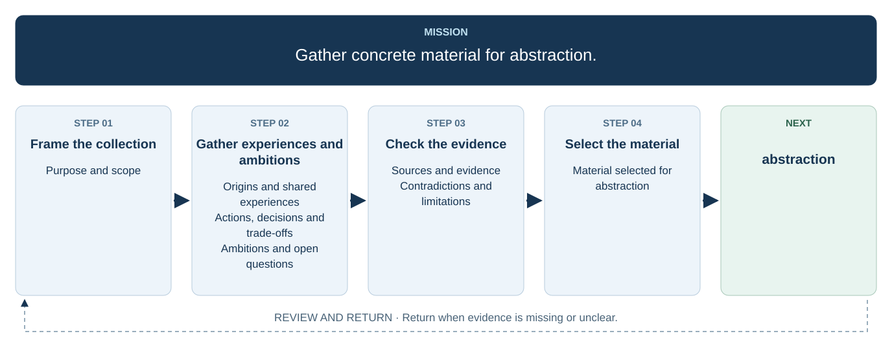

# 1. Prepare group material

## Purpose and scope

## Origins and shared experiences

## Actions, decisions and trade-offs

## Ambitions and open questions

## Sources and evidence

## Contradictions and limitations

## Material selected for abstraction
