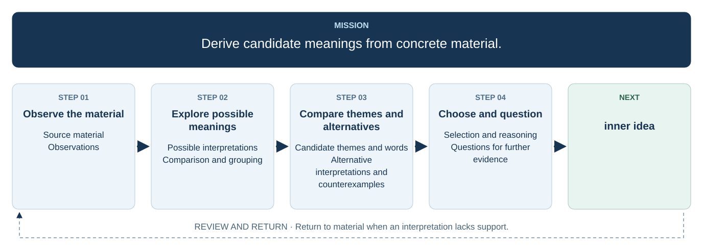

# 2. Abstract the material

## Source material

## Observations

## Possible interpretations

## Comparison and grouping

## Candidate themes and words

## Alternative interpretations and counterexamples

## Selection and reasoning

## Questions for further evidence
