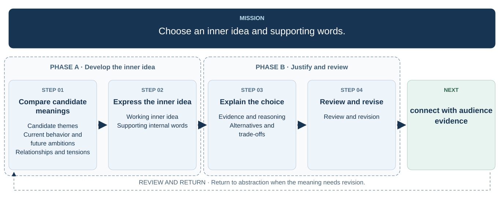

# 3. Choose an inner idea and words

  

[Open the full-size flowchart](./03-inner-idea-flowchart.svg)

## Candidate themes

## Current behavior and future ambitions

## Relationships and tensions

## Working inner idea

## Supporting internal words

## Evidence and reasoning

## Alternatives and trade-offs

## Review and revision
