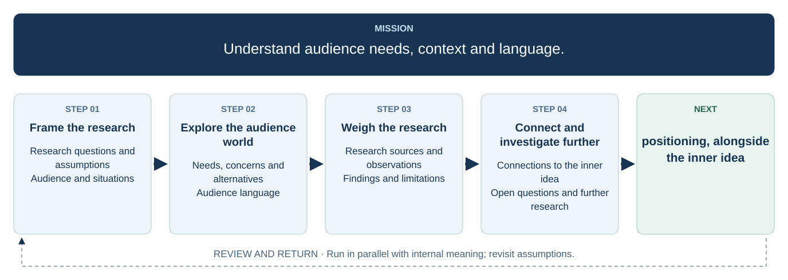

# 4. Research the audience

  

<a :href="flowchartUrl">Open the full-size flowchart</a>

## Research questions and assumptions

## Audience and situations

## Needs, concerns and alternatives

## Audience language

## Research sources and observations

## Findings and limitations

## Connections to the inner idea

## Open questions and further research

