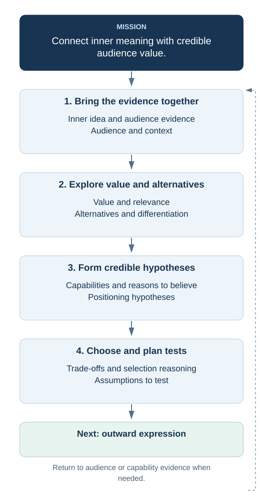

# 5. Define positioning

  

[Open the full-size flowchart](./05-positioning-flowchart.svg)

## Inner idea and audience evidence

## Audience and context

## Value and relevance

## Alternatives and differentiation

## Capabilities and reasons to believe

## Positioning hypotheses

## Trade-offs and selection reasoning

## Assumptions to test
