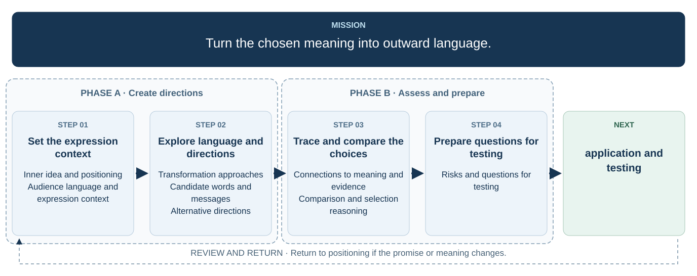

# 6. Transform into outward language

  

## Inner idea and positioning

## Audience language and expression context

## Transformation approaches

## Candidate words and messages

## Alternative directions

## Connections to meaning and evidence

## Comparison and selection reasoning

## Risks and questions for testing
