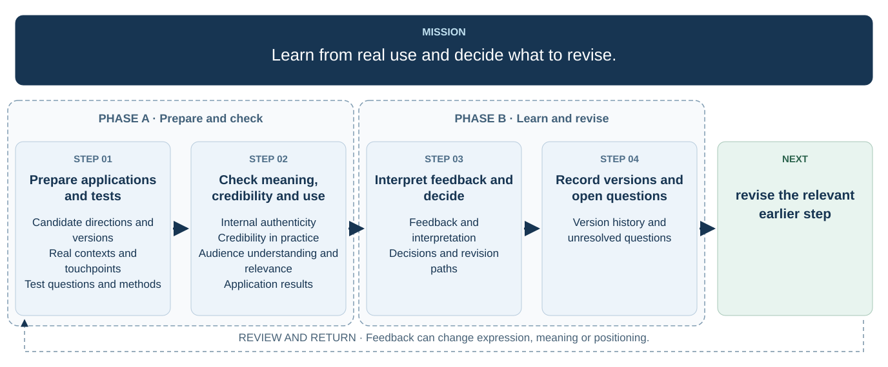

# 7. Apply, test and refine

  

[Open the full-size flowchart](./07-testing-flowchart.svg)

## Candidate directions and versions

## Real contexts and touchpoints

## Test questions and methods

## Internal authenticity

## Credibility in practice

## Audience understanding and relevance

## Application results

## Feedback and interpretation

## Decisions and revision paths

## Version history and unresolved questions
