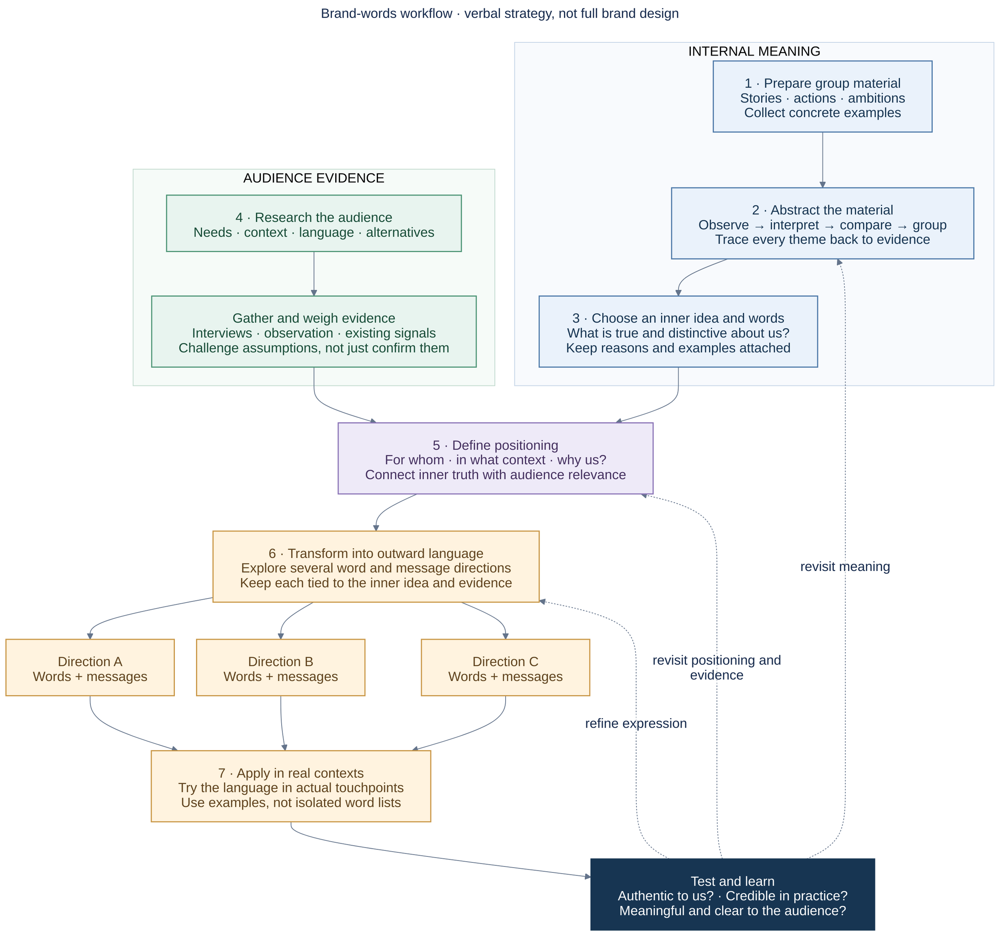

# The Words

The Words is one part of brand design: discovering the brand's inner meaning and turning it into clear, credible outward language. Visual identity and other parts of the brand have their own documentation.

## Our workflow

This is the working flowchart developed in our brand-words discussion on 6 November 2026. It organizes the process; it does not establish Project Pig's final positioning, words, or brand rules.

<a :href="flowchartUrl">Open the full-size flowchart</a>

## Read the flow

1. **Prepare group material.** Collect concrete stories, actions, ambitions, and questions. Separate what has happened from what we hope to become.
2. **Abstract the material.** Observe, interpret, compare, group, and name possible themes. Keep evidence and alternative interpretations attached.
3. **Choose an inner idea and words.** Select the meanings that are true and distinctive about the group, with reasons and examples. These are not necessarily customer-facing words.
4. **Research the audience.** Learn about needs, context, language, and alternatives. Gather and weigh evidence rather than only confirming assumptions. This work can develop alongside the internal meaning.
5. **Define positioning.** Connect the inner idea with audience relevance: for whom, in what context, what value, and why us? Treat the result as a hypothesis to test.
6. **Transform into outward language.** Explore several directions for words and messages, each connected to the inner idea and evidence.
7. **Apply in real contexts, then test and learn.** Try realistic touchpoints rather than isolated word lists. Check authenticity, credibility, audience understanding, and usefulness.

Testing can lead back to expression, meaning, or positioning and evidence. The workflow is a loop, not a one-way checklist.

## Related brand work

- [Brand overview](../)
- [Visual identity](../visual-identity)
- [Voice and writing](../voice-and-writing)

## Editable Mermaid source

Show the source used to draw this flowchart

